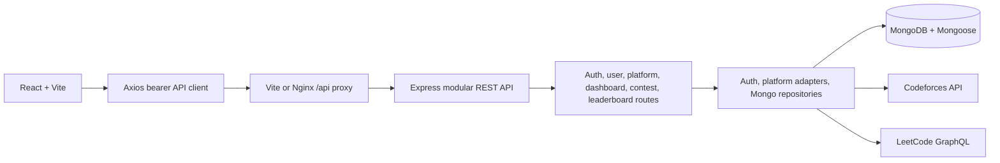

# CodingHub

CodingHub brings public competitive-programming and interview-practice profiles, progress snapshots, coding contests, and personal contest reminders into one React app.

## Features

- React 19 + Vite responsive frontend.
- Express 5 REST API under `/api/v1`.
- Registration/login with scrypt password hashes and signed bearer tokens.
- Per-user coding profile connections; live statistic sync for Codeforces and LeetCode.
- Contest search/filter/pagination, contest ownership, and reminders.
- Per-user dashboard and public leaderboard based on synced stats (unknown stats remain `null`).
- Problem Details errors, request IDs, CORS allowlist, Helmet, input-size limit, conditional GET, idempotency for contest creation, and rate limits.
- MongoDB persistence through typed Mongoose models, with durable idempotency and rate-limit records.

CodeChef, HackerRank, and AtCoder are visible in the catalog but do not currently have automatic stats sync. Contest feed data must be inserted into the API; no external contest feed is configured.

## Architecture



See [architecture and data model](docs/architecture.md), [project brief](docs/brief.md), [OpenAPI contract](docs/openapi.yaml), and [implementation audit](docs/audit.md). The active backend entry is `backend/src/server.ts`; MongoDB connection and schemas are in `backend/src/config/db.ts` and `backend/src/models/`.

## Run locally from scratch

Requirements: Node.js 22.12+ (or 24+), npm, Docker Desktop, and Docker Compose.

```powershell
npm.cmd --prefix frontend ci
npm.cmd --prefix backend ci
if (!(Test-Path backend/.env)) { Copy-Item backend/.env.example backend/.env }
if (!(Test-Path .env)) { Copy-Item .env.example .env }
if (!(Test-Path .env.local)) { Copy-Item backend/.env.example .env.local }
```

Set private local values in the ignored `.env`, `.env.local`, and `backend/.env` files. The root `.env` configures the Mongo container; `.env.local` supplies the direct `MONGODB_URI` for a backend running on your computer. Use the same Mongo username/password in both files. Start MongoDB, then the React and Express development servers:

```powershell
docker compose up -d mongo
npm.cmd run dev
```

Open the Vite URL printed in the terminal (normally <http://localhost:5173>). If that port is occupied, Vite selects the next free port, such as 5174. The frontend proxies `/api` to the API at <http://localhost:5000>. MongoDB runs in Docker with a persistent named volume and publishes only on a loopback port for direct development. If port 27017 is occupied, set `MONGO_PORT=27019` in root `.env` and use port 27019 in `.env.local`'s `MONGODB_URI`.

To run either part separately:

```powershell
npm.cmd --prefix backend run dev
npm.cmd --prefix frontend run dev
```

For a production build, run `npm.cmd run build` and `npm.cmd --prefix backend start` (use a static web server to serve `frontend/dist` and proxy `/api` to the backend).

## Environment variables

| Variable | Default | Purpose |
|---|---|---|
| `PORT` | `5000` | API listen port. |
| `FRONTEND_URL` | `http://localhost:5173` | Comma-separated allowed browser origins. |
| `TRUST_PROXY_HOPS` | `0` | Trusted reverse-proxy hops; use `1` only when the API is behind the included Nginx proxy. |
| `ENABLE_HSTS` | `false` | Set to `true` only when the public deployment is served over HTTPS. |
| `JWT_SECRET` | Development-only fallback | Signing secret; configure a random value of 32+ characters in production. |
| `MONGODB_URI` | Required | Mongo connection string. Use `localhost:<MONGO_PORT>` for an API running on the host; Compose sets the service hostname `mongo:27017` for the containerized API. |
| `MONGO_INITDB_ROOT_USERNAME` | Set in root `.env` | MongoDB container administrator name. |
| `MONGO_INITDB_ROOT_PASSWORD` | Set in root `.env` | MongoDB container administrator password; keep it private and use URL-safe characters for the sample URI. |
| `MONGO_PORT` | `27017` | Host loopback port published by the Compose MongoDB service. Change it if another local service already owns that port. |
| `AUTH_RATE_LIMIT` | `20` | Requests per auth IP per `AUTH_RATE_WINDOW_MS`. |
| `AUTH_RATE_WINDOW_MS` | `900000` | Auth rate-limit window in milliseconds. |
| `PROFILE_SYNC_RATE_LIMIT` | `10` | Sync requests allowed per user in the sync window. |
| `PROFILE_SYNC_RATE_WINDOW_MS` | `900000` | Profile sync rate-limit window in milliseconds. |
| `CONTEST_CREATE_RATE_LIMIT` | `30` | Contest creations allowed per user per window. |
| `CONTEST_CREATE_RATE_WINDOW_MS` | `3600000` | Contest creation rate-limit window in milliseconds. |
| `PROFILE_SYNC_TIMEOUT_MS` | `12000` | Per-attempt outbound request timeout. |
| `CODEFORCES_API_URL` | `https://codeforces.com/api` | Codeforces API base URL. |
| `LEETCODE_GRAPHQL_URL` | `https://leetcode.com/graphql/` | LeetCode GraphQL endpoint. |

For Docker Compose, copy `.env.example` to root `.env`; Compose constructs the API's Mongo URI with the `mongo` service hostname. The backend's `.env.example` shows the separate `localhost` URI for direct host execution. Secrets are ignored by Git.

## API

All routes use `/api/v1`. Protected endpoints require `Authorization: Bearer <token>`. JSON errors use `application/problem+json`. Authenticated responses are `private, no-store`; public catalog/contest/leaderboard reads include ETags and support `If-None-Match`.

| Resource | Operations |
|---|---|
| Health | `GET /health` |
| Auth | `POST /auth/register`, `POST /auth/login`, `GET /auth/me` |
| Users | `GET /users/me`, `PATCH /users/me`, `DELETE /users/me` |
| Platforms | `GET /platforms`, `GET /platforms/connected`, `PUT /platforms/:platformId`, `POST /platforms/:platformId/sync`, `DELETE /platforms/:platformId` |
| Dashboard | `GET /dashboard` |
| Contests | `GET /contests`, `GET /contests/:contestId`, `POST /contests`, `PATCH /contests/:contestId`, `DELETE /contests/:contestId` |
| Reminders | `GET /contests/reminders`, `PUT /contests/:contestId/reminder`, `DELETE /contests/:contestId/reminder` |
| Leaderboard | `GET /leaderboard` |

Contest lists accept `page`, `limit` (maximum 100), `platform`, `status`, and `search`. Contest creation accepts optional `Idempotency-Key` (24-hour replay window); reusing a key with another body returns `409`. Contest edits accept optional `If-Match`; stale tags return `412`. See [OpenAPI](docs/openapi.yaml) for schemas and response codes.

### Main profile-sync flow

1. Save the public platform handle with `PUT /api/v1/platforms/:platformId`.
2. Call `POST /api/v1/platforms/:platformId/sync` with the same bearer token.
3. Read updated data from `GET /api/v1/platforms/connected` or `GET /api/v1/dashboard`.

The sync endpoint retries only transient provider failures, at most twice. Unknown handles and unsupported providers are reported without fabricated stats.

## JSON data migration

The previous JSON file is not changed or deleted by the application. With MongoDB running and the backend `.env` configured, run the importer from the repository root:

```powershell
npm.cmd --prefix backend run migrate:json
```

By default it reads `backend/data/store.json`; set `CODINGHUB_JSON_IMPORT_PATH` to import another file. Imports use upserts and preserve existing IDs/relationships; rerunning does not duplicate records or overwrite an existing Mongo document. The command prints source and Mongo document counts without printing account data. Verify those counts against the summary from the source file and leave the JSON file available as a backup until you have confirmed the application data. The local JSON file inspected during this pass has 4 users and 3 profile groups; it has no contests, reminders, or idempotency records.

API state, idempotency results, and rate-limit windows are stored in MongoDB. Atomic unique indexes protect user email, profiles, reminders, and idempotency keys across backend instances. The API starts only after MongoDB connects and its indexes initialize. See [data ownership and constraints](docs/architecture.md).

## Docker

```powershell
if (!(Test-Path .env)) { Copy-Item .env.example .env }
# Set unique JWT and MongoDB passwords in .env before launching.
docker compose up --build
```

The frontend is available at <http://localhost:8080>; Nginx proxies `/api` to Express. MongoDB starts first and must pass its authenticated health check before the API starts. A named volume persists MongoDB data. `docker compose down` preserves it; `docker compose down -v` deletes it.

## Verification

```powershell
npm.cmd test
npm.cmd run lint
npm.cmd run build
npm.cmd --prefix backend run build
python -c "import yaml; yaml.safe_load(open('docs/openapi.yaml', encoding='utf-8'))"
npx --yes @redocly/cli lint docs/openapi.yaml
docker compose config
```

The test suite uses Node's built-in test runner, an isolated `mongodb-memory-server` database, and native fetch; it never connects to the development URI. Its first run downloads a local MongoDB test binary. `docs/http-log.md` contains public read-only HTTP examples. `docs/network-analysis.md` has reproducible DevTools steps; measured browser evidence is pending.

### Troubleshooting MongoDB

- `MONGODB_URI is required`: create `.env.local` from `backend/.env.example`, then set its host-run Mongo URI.
- `ECONNREFUSED localhost:27017`: start the Compose `mongo` service and check `docker compose ps`. If the port is occupied, use the same free port in root `.env` (`MONGO_PORT`) and `.env.local` (`MONGODB_URI`).
- Authentication errors: ensure the Mongo username/password in root `.env` matches the direct backend URI in `.env.local`; encode reserved URI characters or use a URL-safe random password.
- API container cannot resolve `localhost`: use the Compose `mongo` hostname; Compose already supplies it in `MONGODB_URI`.
- Test binary download fails: rerun with working access to `fastdl.mongodb.org`, or set `MONGOMS_DOWNLOAD_DIR` to a writable cache path.
