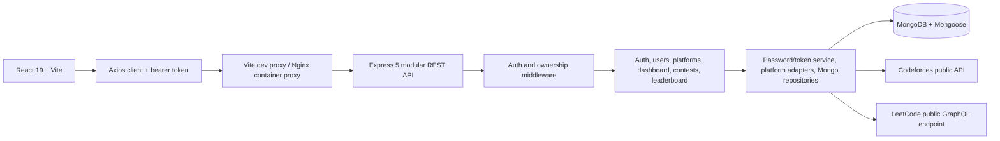

# Architecture and data model

## Runtime architecture



## Document/data model

```mermaid
erDiagram
  USER ||--o{ CONNECTED_PROFILE : owns
  USER ||--o{ REMINDER : saves
  USER ||--o{ CONTEST : creates
  USER ||--o{ IDEMPOTENCY_RESULT : requests
  CONTEST ||--o{ REMINDER : references
  USER {
    string id PK
    string name
    string normalizedEmail
    string passwordHash
    datetime createdAt
  }
  CONNECTED_PROFILE {
    string platformId
    string handle
    number rating_nullable
    number solved_nullable
    string syncStatus
    datetime lastSyncedAt_nullable
  }
  CONTEST {
    string id PK
    string title
    string platform
    datetime startAt
    string url
    string status
    string createdBy FK_reference
    datetime createdAt
  }
  REMINDER {
    string contestId FK_reference
  }
  IDEMPOTENCY_RESULT {
    string requestKey
    string fingerprint
    integer responseStatus
    datetime expiresAt
  }
```

User and contest IDs remain UUID strings to preserve the existing API and imported references. MongoDB enforces unique normalized user email, one platform profile per user, one reminder per user/contest, and one idempotency key per scope. Profile, reminder, creator, and idempotency relationships use those stable string IDs. Password hashes are excluded by default from user queries and removed from every public projection.

The production entry point is `backend/src/server.ts`, built to `backend/dist/server.js`. It waits for MongoDB and index initialization before opening the HTTP listener and disconnects on shutdown. The API, routes, middleware, services, database models, and migration are TypeScript sources.

## Capability and ownership boundaries

| Module | Responsibility | Data authority |
|---|---|---|
| Auth routes/service | Register, authenticate, sign bearer tokens, return safe user projections. | MongoDB user records and password hashes. |
| User routes | Edit or delete the authenticated user's account. | User record, profile/reminder cleanup, authored contests, and owned idempotency results. |
| Platform routes/adapters | Catalog read, connect/disconnect, request profile sync. | MongoDB profile documents; external sites remain authoritative for stats. |
| Contest routes | Public list/detail; authenticated create/edit/delete and reminder operations. | Contest records; creator controls mutation; each user's reminders are private. |
| Dashboard | Compose one user's connected profiles and reminders and calculated aggregate stats. | Read-only projection. |
| Leaderboard | Aggregate only profile stats that have actually synced. | Public user names and aggregate profile statistics. |
| Mongo models/repositories | Validate and persist domain records, reminders, request results, and rate limits. | MongoDB collections and indexes. |

## API operation contracts

| Operation | Authentication | Input | Success | Main failures |
|---|---|---|---|---|
| `POST /auth/register` | Public | JSON `name`, `email`, `password` | `201`, `Location`, safe user and bearer token | `409`, `422`, `429` |
| `POST /auth/login` | Public | JSON `email`, `password` | `200`, safe user and token | `401`, `429` |
| `GET /auth/me` | Bearer | None | `200`, safe user | `401` |
| `GET /platforms` | Public | None | `200`, cacheable catalog with ETag | `406` |
| `GET /platforms/connected` | Bearer | None | `200`, caller's profile array, no-store | `401` |
| `PUT /platforms/{platformId}` | Bearer | JSON `handle` | `200`, connected profile | `401`, `404`, `422` |
| `POST /platforms/{platformId}/sync` | Bearer | None | `200`, refreshed profile snapshot | `401`, `404`, `429`, `501`, `502`–`504` |
| `DELETE /platforms/{platformId}` | Bearer | None | `204` | `401`, `404` |
| `GET /dashboard` | Bearer | None | `200`, caller's dashboard; no-store | `401` |
| `GET /contests` | Public | `page`, `limit`, `platform`, `status`, `search` | `200`, page + summary; ETag | `406`, `422` |
| `GET /contests/{contestId}` | Public | Contest ID | `200`, contest; ETag | `404` |
| `POST /contests` | Bearer | Contest JSON; optional `Idempotency-Key` | `201`, `Location`, created contest | `401`, `409`, `422`, `429` |
| `PATCH /contests/{contestId}` | Bearer owner | Changed contest fields; optional `If-Match` | `200`, updated contest + ETag | `401`, `403`, `404`, `412`, `422` |
| `DELETE /contests/{contestId}` | Bearer owner | Contest ID | `204` | `401`, `403`, `404` |
| `GET /contests/reminders` | Bearer | None | `200`, caller's reminders; no-store | `401` |
| `PUT /contests/{contestId}/reminder` | Bearer | Contest ID | `200`, caller's updated reminder list | `401`, `404` |
| `DELETE /contests/{contestId}/reminder` | Bearer | Contest ID | `200`, caller's updated reminder list | `401`, `404` |
| `GET /leaderboard` | Public | None | `200`, observed aggregate stats; ETag | `406` |

All errors use `application/problem+json` and include stable `type`, `title`, `status`, `detail`, `instance`, and `requestId` fields. `message` remains as a compatibility extension for the current frontend.

## Quality evaluation

- **Reachability:** Vite serves the React app and proxies `/api` to the Express process in development; the Docker frontend proxy provides the same path in deployment.
- **Self-containment:** Compose starts MongoDB with a health check, persistent named volume, and health-gated API dependency.
- **Contract clarity:** `/api/v1` separates resource routes and documents inputs, auth, responses, and error types in OpenAPI.
- **Independence:** Provider fetching is behind adapter functions. The app remains usable for all other features when a provider is down.
- **Loose coupling:** React calls the API client; route modules use Mongoose-backed data operations. Mongo unique indexes and atomic rate/idempotency writes support multiple API processes.

## Database decision and constraints

Mongoose schemas define users, connected profiles, contests, reminders, idempotency records, and shared rate-limit buckets. MongoDB indexes enforce uniqueness and expire old idempotency/rate-limit records. API reads use Mongo filters, sort, and pagination. The migration tool uses insert-only upserts to retain IDs and avoid duplicate imports; it does not mutate or remove the JSON source. MongoDB is run as one local Compose service; the API has no process-local persistence requirement.

Important runtime constraints: user IDs and contest IDs are UUID strings; names are 2–80 characters; emails are normalized lowercase and capped at 254 characters; passwords are 8–256 characters and stored as an scrypt salt/hash string. Platform IDs come from the catalog and handles are 1–80 characters. Contest title, platform, start time, HTTP(S) URL, and status are validated. Contest list pages are positive integers with a maximum page size of 100. Credentials are environment-only; Compose uses the `mongo` hostname inside its network and publishes a loopback port for host development.

## Caching and retry safety

- Public platform catalog: `public, max-age=300, stale-while-revalidate=60`, entity tag, `If-None-Match` support.
- Public contest list/details and leaderboard: short public cache and entity tags.
- Authenticated API data: `private, no-store`.
- Helmet sends `X-Content-Type-Options: nosniff`; HSTS is opt-in with `ENABLE_HSTS=true` and should only be enabled when the public site is HTTPS.
- Contest creation accepts `Idempotency-Key`, stores the request fingerprint and original response for 24 hours, replays exact matches, rejects body mismatches with `409`, and uses a unique Mongo key plus expiring lease for concurrent API instances.
- Contest `PATCH` checks an optional strong `If-Match`; stale writes return `412`.
- Contest reminder `PUT`/`DELETE` are naturally repeatable. Other POST operations must not be automatically retried without an idempotency contract.
- Profile synchronization has a configurable deadline and retries transient upstream failures at most twice with exponential backoff and jitter. Validation/client errors are not retried.

## SOAP evaluation

There is no external SOAP partner or SOAP-specific business operation in the current product. Adding a SOAP runtime would create an unrelated production dependency. The REST/OpenAPI contract is the service interface; SOAP is recorded as not applicable for this product scope.
